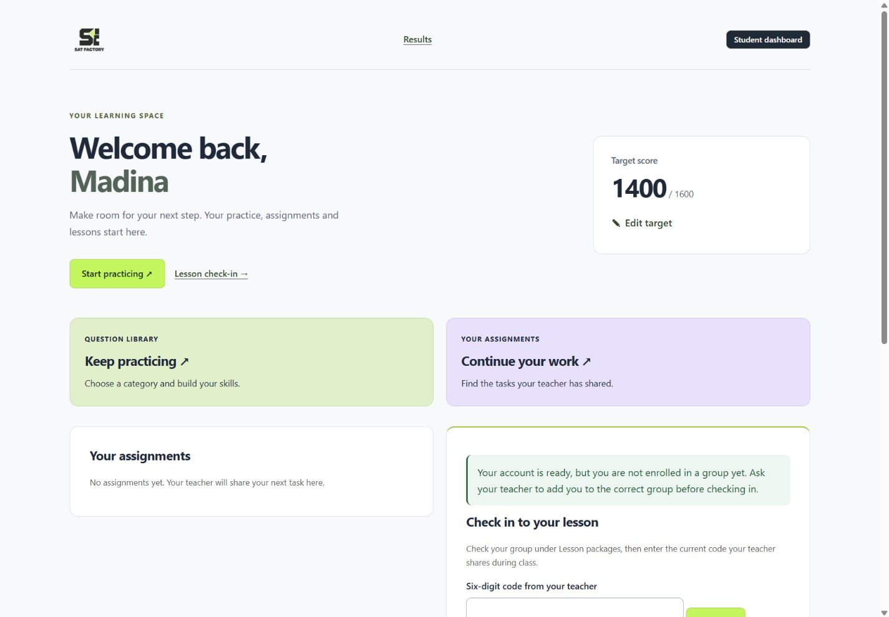

# SAT Factory

**A course-management and SAT practice application built around real classroom workflows.**

SAT Factory brings student enrollment, lesson attendance, lesson credits, question
practice and group assignments into one teacher/student portal. It also includes a
public course website with student results and teacher information.

This is both a working course project and a portfolio of practical backend and
product-development decisions: protecting balances under concurrent requests,
keeping an audit trail, making retries safe, recovering SQLite data, and designing
usable server-rendered screens.

**Status:** actively developed for a supervised course pilot. Local simulations and
automated checks exist; they do not establish production readiness or real-classroom
acceptance. Public deployment is not part of this repository update.



*Student dashboard preview using fictional test data.*

## What it does

| Area | Implemented behavior |
| --- | --- |
| Course operations | Teacher-created accounts, groups, enrollment, password resets and enrollment deactivation |
| Attendance | Expiring lesson codes, saved rosters, live teacher feedback and safe student retries |
| Lesson lifecycle | Reopen check-in for an unfinished lesson; permanently finish it or cancel an eligible empty lesson |
| Lesson credits | Twelve-lesson packages, manual early/late renewals, lessons owed and audited balance corrections |
| Question Bank | Categories, four-choice authoring, reviewed publication, optional explanations and supported PDF imports |
| Student practice | Server-side grading, bookmarks, browser-local text highlights and retry history |
| Assignments | Group recipient snapshots, pinned question revisions, deadlines, completion and teacher progress reports |
| Student dashboard | Practice/assignment shortcuts, lesson check-in and a compact editable target score |
| Public website | Results gallery, manually switchable score spotlight and teacher profile |

Assignments and independent practice maintain separate attempts. Completion means
answering every assigned question, not answering every question correctly. First-try
and later success remain distinguishable. Target score is a personal goal, not an
SAT score prediction. Exam-date/countdown controls are no longer part of the UI.

## Engineering decisions

- **Server-rendered by design.** FastAPI and Jinja2 keep navigation and core forms
  usable without a frontend framework. Small JavaScript modules add feedback,
  polling, highlighting and result switching.
- **Record-based balances.** Packages, effective attendance and audited corrections
  determine credits and debt per enrollment; a manually edited counter is not the
  source of truth.
- **Atomic writes and safe retries.** SQLite immediate transactions serialize critical
  checks and writes. Submission keys recognize duplicate requests after a lost response.
- **Historical integrity.** Published question revisions and assignment recipients
  are snapshots. Corrections retain earlier records instead of rewriting history.
- **Authorization at the write boundary.** Server-side role/session checks, CSRF,
  revocable sessions, password hashing and persisted rate limits protect key flows.
- **Recovery is exercised.** SQLite-consistent backups, separate-destination restores,
  record reconciliation and session revocation are tested with fictional records.
- **Explicit time handling.** Operational timestamps are stored in UTC and displayed
  in Asia/Tashkent.

These controls have automated coverage; this is not a claim of an external security
certification or exhaustive penetration testing.

## Stack and structure

Python 3.14 · FastAPI · SQLAlchemy · SQLite · Jinja2 · HTML/CSS · plain JavaScript

| Location | Responsibility |
| --- | --- |
| `app/main.py` | Application assembly, middleware and public routes |
| `app/models.py`, `app/database.py` | Course records, database initialization and write transactions |
| `app/security.py` | Passwords, sessions, CSRF and attendance/login limits |
| `app/attendance.py`, `app/packages.py` | Attendance and lesson-credit rules |
| `app/student.py`, `app/teacher.py` | Student and teacher workflows |
| `app/question_bank/` | Question revisions, authoring, publication, practice, assignments and migrations |
| `app/templates/`, `app/static/` | Server-rendered pages, scoped styles and progressive enhancements |
| `app/result_content.py` | Curated public results, separate from private course records |
| `scripts/` | Isolated verification, fictional demos, recovery and local operational tools |
| `tests/` | Python integration/domain tests and Node behavior checks |
| `docs/` | Backlog, design decisions, verification evidence and operator guidance |

## Try it safely

Requirements: Python 3.14, Git, and Node.js for JavaScript verification. The primary
local workflow is Windows/PowerShell; use your platform's virtual-environment Python
path if running elsewhere. The desktop launcher is Windows-specific.

```powershell
py -3.14 -m venv .venv
.\.venv\Scripts\python.exe -m pip install -r requirements.txt
.\.venv\Scripts\python.exe scripts/demo_class.py
```

The demo asks for a disposable password privately, creates 30 fictional students
and a teacher in temporary storage, and uses an isolated session secret. Open
<http://127.0.0.1:8766>. Log in as `demo-teacher` or `demo-00` through `demo-29`
with the password you chose. Stop with Ctrl+C. The demo does not use the working
course database, and its data is temporary. It is a classroom walkthrough, not a
seeded catalogue of licensed SAT questions.

## Run a persistent local instance

Use a fresh checkout for evaluation. For an existing course instance, follow the
[backup and upgrade instructions](docs/backup-recovery.md) before changing versions:
startup may apply additive schema changes.

```powershell
.\.venv\Scripts\python.exe -m app.create_user teacher --name "Teacher" --role teacher
.\.venv\Scripts\python.exe -m uvicorn app.main:app --reload --host 127.0.0.1 --no-proxy-headers
```

Account creation prompts for a password; there are no default credentials. Create
the teacher once, then manage students through the app. Visit
<http://127.0.0.1:8000>. Development reload is for local work, not production.

The existing Windows desktop shortcut uses `scripts/open_sat_factory.py` to restart
this checkout's local server and open the browser. Restart between lessons: active
requests can be interrupted. An unrelated process on port 8000 is not terminated.

## Verify changes

One command runs the guarded Python suite, all Node behavior checks, dependency
compatibility and staged/unstaged whitespace checks. It stops on the first failure.

```powershell
.\.venv\Scripts\python.exe scripts/check.py
```

For a small backend change, begin with the relevant test module:

```powershell
.\.venv\Scripts\python.exe scripts/verify.py --pattern test_student_goals.py
```

Do not substitute bare unittest discovery: importing the normal app can read the
working session secret. The guarded runner redirects secrets and blocks the default
live database engine before tests import the app. Tests use fictional databases.
`pip check` checks dependency compatibility, not new vulnerability advisories.

The fictional 30-student simulation covers concurrent answer submissions and
retries. It is not a substitute for real phones, classroom Wi-Fi, sustained load,
or deployment verification. See the [current handover](docs/pilot-handover.md) for
exact commands, results and limitations.

## Everyday development workflow

1. Read the latest handover and backlog; inspect Git status before editing.
2. Select one bounded feature or demonstrated defect. Preserve unrelated changes.
3. Implement and run the smallest relevant isolated checks; review mobile and
   keyboard behavior for UI changes.
4. Run `scripts/check.py` before a shared checkpoint. Review the diff and staged
   paths, then make a focused commit. Push only when authorized.
5. Record evidence and the next step in the handover. Do not mark simulated checks
   as owner acceptance or production validation.

See [CONTRIBUTING.md](CONTRIBUTING.md) for the practical checklist.

## Operations, limitations and next work

- Teachers issue/reset student credentials and record renewals; there are no online payments.
- Public guest practice is available at `/questions` without login. Account-saved
  practice still requires active enrollment. Assignment access also requires
  saved recipient membership. Teachers share one course business; assignment reports
  are scoped to their creator.
- Only documented PDF layouts are supported. Imports require review; arbitrary PDFs
  are not guaranteed to parse. The import-review cache is process-local.
- Highlights are stored in the student's browser, not synced between devices.
- Assignment lists show the latest 100 tasks. Long-lived history and multiple server
  workers need further evaluation before scaling.
- HTTPS, production secrets/cookies, host/proxy configuration, persistent storage,
  operational backups and supervised pilot approval remain release prerequisites.
- Performance analysis and automatic study recommendations remain future work.

| Guide | Purpose |
| --- | --- |
| [Product backlog](docs/product-backlog.md) | Scope, delivery updates and outstanding work |
| [Question Bank plan](docs/question-bank-plan.md) | Question and assignment architecture/delivery |
| [Backup and recovery](docs/backup-recovery.md) | Consistent backup, restore and rollback |
| [Security review](docs/security-checklist-review.md) | Implemented controls and remaining requirements |
| [PDF imports](docs/pdf-upload.md) | Supported formats and review workflow |
| [Package accounting](docs/packages.md) | Early renewal, credit and lessons owed |
| [Scrum agreement](docs/scrum-working-agreement.md) | Lightweight delivery and review process |

## Data and attribution

Never commit working databases, backups, passwords, session secrets, private student
records or local import material. Generated previews and artifacts under `output/`
are ignored; previously tracked branding references remain in history. The public
course content is deliberately separate from private operational records.

This portfolio demonstrates the application's engineering. It does not grant
redistribution rights to third-party questions, source PDFs, student statements or
branding. Bundled third-party assets retain their accompanying license notices.


### Resettable portfolio sandbox

Run `.venv\Scripts\python.exe scripts/portfolio_demo.py`, then open
<http://127.0.0.1:8767/login>. Demo access is shown on the login page.
This creates a separate temporary database with six fictional students, a teacher,
attendance history, three original sample questions and an assignment. Stop and
restart it to reset all demo activity. No existing accounts or database are used.
See [demo instructions and hosting limits](docs/portfolio-demo.md).


### Public Question Library

The homepage Free practice link opens `/questions`. Only published revisions are
visible. Guests can browse categories and answer questions without an account;
answers/explanations stay hidden until a correct answer or a second submission.
Explanations remain collapsed. Publishing a question now makes it public, including
already published questions. Review permission to redistribute imported material
before any public deployment; no rights verification is implied by publication.

Guest results and bookmarks use browser localStorage (latest 2,000 revisions and
1,000 bookmarks), shared by people using the same browser profile. They do not sync
or merge into student accounts. Clearing browser storage removes them. A bounded
signed session cookie retains the last six question checks for retry/disclosure;
its loss/expiry or eviction resets that short-term check history. Guest history is
for self-study, not grades; concurrent tabs/cookie replay are not authoritative.
No guest attempts or bookmarks are inserted into the course database.

Enrolled students entering `/questions` are redirected to existing account-saved
practice. Other visitors (including teachers) use guest mode. Assignments,
attendance and teacher authoring keep existing authorization rules.

Public requests are bounded per process/IP: 240 reads or 30 answer submissions per
minute, maximum 10,000 active limiter buckets. Cookies cannot reset this budget.
Limits reset on restart, may be shared behind NAT, and are not distributed across
workers. Configure trusted proxy addresses at the host; do not trust arbitrary
forwarding headers. The demo host keeps its additional global/lifetime limits and
allows only the new public answer POST, not authoring. No deployment is performed.
Restart the normal server to register new routes; no database migration is needed.
